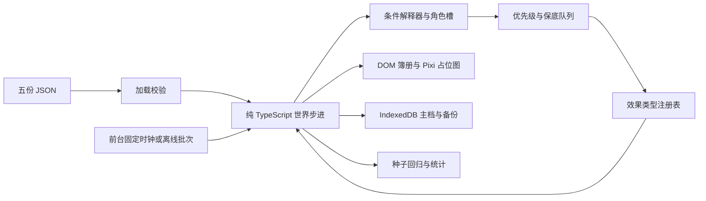

# 模拟仙府 M2 · v1.1 架构与验证边界

## 设计依据（只读引用）

完整系统依据：`/Volumes/Media/immortal-qa/design/02-systems-and-events.md`（v1.1）。逐条决定：`/Volumes/Media/immortal-qa/design/02a-design-decisions.md`。
参考：同目录 `01-gameplay-core.md`、`03-web-tech-proposal.md`、`art/ART-STYLE-WEB-v1.md`。
设计源文件不复制入仓库。

## 数据与执行路径



- `data/traits.json`：恰好 10 种，效果参数、关系系数、互斥表和配饰。
- `data/buildings.json`：恰好 5 种，开局等级、升级上限、容量、成本、工期、产出、解锁条件、预留位。
- `data/events.json`：恰好 20 个，9 通用，A/B/C 各 3 个，D 2 个；包含条件树、角色槽、概率、冷却、保底、分支及可用选项。
- `data/balance.json`：原 M1 常量移入 JSON；包含灵根权重、五行色与倾向、需求与评分、寿元、公式、仓库、调度、离线分段及自动建造顺序。
- `data/roster.json`：六人固定开局，年龄与总寿元/余寿分开保存，人生阶段在创建世界时计算。
- `data/initial.json`：保留的 M1 旧数据样本，不再用于新局。默认加载资源与建筑来自 balance/buildings，弟子来自 roster。`loadData(raw)` 仍接受 M1 数据入口，保留其错误路径约定。

`schema.ts` 定义事件、条件、效果与目录 schema；`catalog.ts` 校验并加载；`data.ts` 校验弟子与初始世界；`config.ts` 对 balance 全字段类型与有限数值校验。数量、重复编号、未知条件/效果类型、缺少关键条件参数、提示/正文长度、互斥特质均拒绝加载。错误带中文文件和字段路径。

世界只保存可序列化对象，无 DOM、系统时间或 `Math.random`。随机状态含 seed/state/calls；所有平局、角色抽取、概率、招新均用同一发生器。生命周期、岗位分配、生产、关系、建造、默认决策、调度每步执行；每 30 步更新年龄、关系回归、建筑声望。日志保留最近 100 条，里程碑 tick 独立保存在 flags，不依赖日志长度统计。

建筑占据固定预留位；升级期间原等级功能继续使用。自动掌门默认开启，依次排药圃、静修室、炼丹房、居舍 Lv2、主殿 Lv2，最早第 1/2/3/4/5 轮开工。自动策略为下一建筑留建设资源；缺灵石/灵草时相应岗位优先，炼丹不挪用主殿建设储备。手动订单仍需满足相同解锁和成本规则。设置可以关闭自动掌门。

## 事件、角色与玩家 API

条件树通过 `matches(world, condition, roles)` 解释：特质、灵根、境界/需求/行为/地点字段、修为满、关系阈值/标签、建筑、资源/声望、前置及间隔、昼夜、人口/容量、受伤/回山/生产信号。`any/all` 组合子条件。角色槽递归筛选完整可行组合，然后按种子和权重抽选；薪火 B 槽先取最高关系。连锁首次选中的角色写入 cast，后续固定沿用，坐化节点仍可找到原角色。

每步检查，两个新事件至少隔 6 步；同人最多一个未结事件。先保底、再优先级，同档按特质/关系权重抽取。最大 5 个，溢出丢最低优先级非连锁；全是连锁时延后。冷却以角色和事件编号为键，从结算时起算。前台按 `balance.scheduler.autoResolveSteps`（当前 30 步）超时默认处理，连锁也适用；完成记录用于下一节点的前置判断。

### 最早轮次与步数边界（Lore 补充决定）

现有条件词表没有世界 tick/round 阈值：`time` 只分昼夜，`field` 读取弟子字段。因此新增 `trigger.earliestRound`，zod 校验为可选正整数，省略等同 1。调度先判定门槛，再进行角色抽取、冷却、保底和概率处理；未到门槛不消耗随机数、不写 `roll:*`，也不占用“每轮首次满足条件掷一次”。

`step()` 开头执行 `w.tick++`；轮末处理在 tick 为 30 的倍数时更新 `w.round`，之后才检查事件。入队的 `createdTick` 和 `flags[first:事件ID]` 均记录此时 tick；结算的 `done:*` 记录结算当步 tick。`scripts/sim.ts` 保持按 ⌈flags 步数/30⌉ 统计，而非直接使用 `w.round`。第 N 轮首步对应 tick = (N−1)×30+1（调用 step 前为 (N−1)×30），该轮末步为 N×30。

EV_ADV_01 的 `earliestRound = 3`：tick 60 属第 2 轮，不可触发；tick 61 属第 3 轮，可以参与调度。EV_ADV_02 的 `earliestRound = 4`：tick 90 不可触发，tick 91 才可参与。所谓“第 2 轮末起”指完成第 60 步后开始的下一步，不能把第 60 步提前归入第 3 轮。准行结算设置 `awayUntil = tick + 30`，故第 61 步准行，最早第 91 步回山；延迟处理只会更晚。ADV_02 仍显式配置第 4 轮门槛，便于数据独立约束。

方案 2 的 ADV_01/02 每步概率均为 30%，ADV_01 精力门槛为 ≥60；现有每轮 cadence 的 `w.round` 键、间隔和优先级均保持不变。4.3 表 ±1 轮只约束推演表里的里程碑。最早轮次只保证下限，不保证事件一定命中或准时入队。

```ts
resolveEvent(world, eventId, optionIndex); // 返回是否成功；不可用不改变世界
setPolicy(world, discipleId, '专修'); // 均衡、专修、勤工
build(world, 'B_GARDEN'); // 返回是否成功
upgrade(world, 'B_HALL'); // 同订单入口
```

选项先校验条件与成本，再扣资源和执行注册表。动态默认：筑基有三丹用赐丹，否则暂缓。其他带成本默认项不能负担时，自动处理使用首个可用选项；UI 显示成本并禁用不可用按钮。所有资源结算后截断到上限，声望不消耗、无上限。突破失败、延寿、传功、情缘分支、历练、招新、传承均由效果类型注册表执行。

## 离线与保存

沿用 M1 分段积分，按有效轮数循环 30 步，同批次共享小突破计数；最多两次成功小突破，不筑基，年龄最多八轮，余寿最低一轮。离线结束时所有弟子修为截断到当前层的 100/150/200，溢出丢弃；不新开工程，已有工程照常完工。离线为 seed + lastSeen 派生随机状态，保留原 seed。小于零或非有限时间不补算，超过七天截断。

通用事件自动结算；连锁的每个选项节点均视作需玩家决策，最多保留三个，绝不超时自动选。入离线时已有四/五个连锁节点会暂存到可序列化 deferredEvents，回到前台有空间时恢复，避免截断丢剧情。离线汇总含资源、突破、关系档位变化及最多十条提示。零轮不改变世界。已经坐化的人不复活。

存档继续使用版本 2，新增字段有 schema 默认值，旧 M1 世界可载入；旧欢迎事件在超时后移除。版本 1 迁移规则保留。IndexedDB `xianfu/saves` 的 main/backup 同事务更新，导入前校验并备份当前内存进度；写入串行排队，坏档不覆盖健康备份。当前仍无跨标签页写锁，请只开一个主页面。页面关闭后的异步写入由浏览器决定，最近一次成功保存才是可靠恢复点。

## 占位清单

- 山场底图、山路、远景、云雾、预留位：几何图形；只一张山场，右上同场景缩略图，无世界地图。
- 五种建筑两档：矩形/屋顶色块，以等级或建成两轮后换色，进度图标代替工地动画。
- 男/女基础体、八类发型、五行镶边、十配饰、头像：圆点/文字与配饰占位符；镶边采用设计色。
- 四动作仅位置/颜色/箭头、打坐、锤、气泡符号；休息隐藏并在居舍显示 Zzz，历练隐藏，受伤换灰，迟暮标白发，坐化从地图移除。
- 资源、事件类型、状态、关系、配饰图标均为文字或 Unicode 占位；正式图集、配饰拼装和帧动画未接入。
- 老板页为 DOM 工作台账；页签图标为 SVG 字；音频只有开关。
- ≤480 宽隐藏簿册侧栏，底部固定最新待处理事件提示行、朱砂红点与未读数，为提示行预留空间且不遮挡资源栏；点击才打开决策。离线与战报不在紧凑模式主动弹出。

## 待 Lore 确认（逐条决定对照）

以下 26 条已按 02a 核对实际代码；“同意现实现”项中发现的延寿上限遗漏也已修复。主要角色解释口径已确认（Lore 2026-10-29 确认），见下文。

| 项目                | 状态                   | 当前实现与核对依据                                                                                                                                                                               |
| ------------------- | ---------------------- | ------------------------------------------------------------------------------------------------------------------------------------------------------------------------------------------------ |
| 昼夜                | 已决定（02a 第 1 条）  | 前 15 步昼、后 15 步夜。核对 `world.matches(time)` 与 `balance.scheduler.daySteps`。                                                                                                             |
| 每轮 30%            | 已决定（02a 第 2 条）  | 本轮首次合法满足条件掷一次，失败不重掷；保底免掷。D1 仍为 30%，精力 ≥40、保底第 2 轮末。核对 `schedule`，补边界单测。                                                                            |
| 保底碰上间隔/角色忙 | 已决定（02a 第 3 条）  | 保底不越过触发条件、6 步间隔和同人唯一。核对 `schedule/selectRoles`，补实际调度测试。                                                                                                            |
| 开局与预留位        | 已决定（02a 第 4 条）  | 主殿/居舍 Lv1，其余三个空位；升级原位。核对 `buildings.json`、`loadData/build`。                                                                                                                 |
| 开局需求            | 已决定（02a 第 5 条）  | 六人均为精力 90、心境 75、道心 20。逐人核对 `roster.json`。                                                                                                                                      |
| 行为特质系数        | 已决定（02a 第 6 条）  | 多情社交 ×1.5、孤僻 ×0.5、勤勉修炼 ×1.2、懒散做工 ×0.8。核对 `traits.json` 与 `choose`。                                                                                                         |
| 历练基础概率        | 已决定（02a 第 7 条）  | 方案 2：ADV_01/02 每步均 30%，ADV_01 精力 ≥60；剑痴/金/福缘选人权重 ×2、冷却两轮。核对 EV_ADV_01；Lore 补充决定增加 ADV_01 最早第 3 轮、ADV_02 最早第 4 轮。                                     |
| 岗位排序与资源储备  | 已决定（02a 第 8 条）  | 保留 `balance.jobs`：100/10/6/5/3/2/1；核对 `jobs/work` 的建设储备判定。                                                                                                                         |
| 做工评分括号        | 已决定（02a 第 9 条）  | 整个 `(40 + 空缺岗位数×10)` 乘方针和特质。核对 `choose`。                                                                                                                                        |
| 社交关系            | 已决定（02a 第 10 条） | 结束时选择在山、关系最高且 > -20 的对象，双方记一次，双方特质系数相乘，多情不重复乘。核对 `step/socialCoefficient/changeRelation`；原表“不低于 -19”已纠正为实际比较符。                          |
| 知己/道侣等叠加     | 已决定（02a 第 11 条） | 不同关系与标记乘法叠加，多对象逐个生效，暂不封顶。核对 `step` 修炼分支。                                                                                                                         |
| 主殿成本减免        | 已决定（02a 第 12 条） | D2 减免赋值 30，重复不累加；声望不消耗。核对 `hallDiscount/buildingOrder`。                                                                                                                      |
| 丹药产出            | 已决定（02a 第 13 条） | 炼丹一炉一枚；修复历练与通用资源奖励：丹药向下取整，灵石/灵草四舍五入。只取整奖励增量，持续劳作与已有资源不强行取整。核对 `rewardAmount/handlers/work` 并测试。                                  |
| 无力支付默认项      | 已决定（02a 第 14 条） | 统一 `defaultOption` 返回首个付得起且条件可用的退路，不限免费项；CLI 与超时同源。筑基仍按丹药动态默认。新增参数支付测试。                                                                        |
| 冷却作用域          | 已决定（02a 第 15 条） | 结算时记录事件+主角 A，无主角为 sect。核对 `resolveEvent/schedule`，测试不同主角与到期边界。                                                                                                     |
| 事件持续条件        | 已决定（02a 第 16 条） | 触发锁定正文/分支/角色，结算仅重验选项条件及成本。核对 `schedule/resolveEvent`，测试行为改变后仍能结算。                                                                                         |
| 招新                | 已决定（02a 第 17 条） | 十二姓名不放回，每轮签池用尽再重置；抽取记录保存在世界 flags 的 recruitName:姓名，随存档接续。年龄 56～103 季均匀、性别各半、第二特质 50%、杂根 4/5 五行各半。核对 `recruit` 并测试 240 次招新。 |
| 长老寿元            | 已决定（02a 第 18 条） | 改 714 季、寿元 720 季、余寿 6；UI 用 `formatAge` 向下取整显示 178 岁，另显示余寿。修复 `lifespan` 同时增加余寿与寿元上限，不改年龄。                                                            |
| 薪火节奏            | 已决定（02a 第 19 条） | B2 改为 B1 后 ≥1 轮且余寿 ≤3；其他条件不变。数据与阈值边界测试已覆盖。                                                                                                                           |
| 冰与酒节奏          | 已决定（02a 第 20 条） | A 只取多情；C1 要静修室及 B 打坐、保底 2、默认 +20；C2 间隔 1、关系 20、立即 +10 再两轮同修；C3 关系 40、当前成本 0。测试条件、即时与持续效果、无多情不开线。                                    |
| 离线示例            | 已决定（02a 第 21 条） | 分段积分后向下取整为 45/74/160 轮。核对 `computeOffline`，保留边界用例。                                                                                                                         |
| 离线修为囤积        | 已决定（02a 第 22 条） | 改为离线结束所有弟子按当前层截断至 100/150/200；不兑换资源。测试三层 5000 修为分别截断。                                                                                                         |
| 离线粗步长          | 已决定（02a 第 23 条） | 每轮内部复用 30 步，上限 4800 步，未引入 Worker。核对 `applyOffline/advance`。                                                                                                                   |
| 离线自动营造        | 已决定（02a 第 24 条） | 已实现：`step` 离线不调用自动 build，工期照常推进；新增已有工程完工且无新工程测试。                                                                                                              |
| 离线决策节点        | 已决定（02a 第 25 条） | 所有连锁节点暂停，最多三个；入离线前超额节点暂存 deferredEvents，前台恢复。通用事件自动结算，不筑基不坐化。核对 `applyOffline/schedule/resolveEvent`。                                           |
| 回顾本命弟子        | 已决定（02a 第 26 条） | 按大境界、层数、修为排序推荐，未新增选择系统。核对 `app/main.ts` 的故事回顾排序。                                                                                                                |

## 保留参数（本次明确不调整）

| 项目             | 参数                                               | 当前值（严格沿用 v1.1） | 候选值   |
| ---------------- | -------------------------------------------------- | ----------------------- | -------- |
| 无人处理等待步数 | `data/balance.json` → `scheduler.autoResolveSteps` | 30                      | 10       |
| C3 成全灵石成本  | `data/balance.json` → `costs.c3BlessStone`         | 0                       | 10 或 30 |

只改对应 JSON 数值并重新构建/加载即可切换，无需改 TypeScript 或事件效果。等待步数须为正安全整数，成本须为非负安全整数，zod 拒绝非法值。C3 的 `options[0].costBalance.stone = "c3BlessStone"` 引用 `balance.costs`；`optionCost` 统一供 UI、可支付判定和扣款使用（覆盖该资源静态 cost）。测试把等待改为 10，验证第 9 步未结、第 10 步结算；成本改为 10 时扣 10，不足时退到“再等等”。发布配置仍为 30/0。

## 实际验证与边界

方案 2 的命令、单测、种子 42 和两种 100 种子口径结果见 `docs/M2-VALIDATION.md`。默认故事门槛和主殿完成率通过；零操作的故事完成率仍低，30 步等待未经批准不调整。

CLI 记录全部 20 个事件的首次出现中位轮次和命中数，未命中为 null。历史最早轮次版本记录（非方案 2）：默认 ADV_01/02 中位第 4/5 轮（7/4 局），零操作第 5/6 轮（35/17 局）。未据此宣称整个 M2 或浏览器验收完成。

v1.1 浏览器验证（2026-10-29 08:29 UTC+8，执行者在沙箱外用系统 Chrome 无头运行）：`node scripts/e2e.mjs http://localhost:4173/` 六图与断言（含长老“178 岁 / 余寿 6 季”）通过，截图已更新于 docs/screenshots/01~06；`--soak` 短挂机 67 步通过、0 报错。10 分钟长挂机已在历练最早轮次版本重跑通过（见 docs/M2-VALIDATION.md 末节）。

本次最早轮次改动尚未进行浏览器复验，由指挥官运行；上述浏览器记录仅属于改动前 v1.1。

## 历练主要角色排除：已确认（Lore 2026-10-29 确认）

“主要角色”口径已确认（Lore 2026-10-29 确认）。开局数据按 02 第 1.6 节：陆青崖 A；沈墨 A、C；白芷 C；苏小禾 B；钱多多 D；林守拙 B。`roster.json` 的 `storyLines` 经弟子 schema 校验并进入世界/存档；运行时将其与 `cast:<chain>:<slot>` 绑定取并集，覆盖招新角色。招新显式设为空数组，不继承克隆模板的故事线。

任一涉及线仍有效即排除；全部线终点（该 chain 最大 step 的事件）已结算，或当前已无可用的硬条件角色组合才释放。终点入队不算完成。可开性检查不抽随机数，遍历首节点的角色槽，绑定槽沿用已绑定角色；未绑定槽只检查 trait/root 及其 any/all 组合、存活限制和角色互异。精力、关系、地点、建筑、年龄阶段及暂时离山都不用于宣布线路失效；允许坐化角色的 B 槽保留其原规则。队列中还有该线事件时仍算有效。

例如 C 线未绑定、已无多情弟子时解除该线排除；这是基于当前角色池的可开性判断，不永久写“废线”标记。如果随后招新补齐角色，排除重新生效。此可恢复解释同属已确认口径，避免把“当前开不了”伪装成对未来招新的预言。

`roles.<slot>.excludeStoryCast`、`excludeWithPendingEvent` 是可选 boolean，省略不增加该项限制。全局同人唯一仍始终生效，后者在数据中显式声明约束，不允许通过 false 绕过全局规则。选人代码不按事件 ID 分支。

ADV_01/02 的 A 均配置两字段。对于 `allowAway` 且已离山的候选，故事线排除不重验：这是接续既有旅程，回山 A 仍由 `returned` 条件找到原离山者。即使途中新增 chain binding 也不会卡住回山；若该人占着其他未结事件，按现有同人唯一等待，释放后仍受 6 步间隔与既有优先级调度。结算回山效果才清除 awayUntil。没有改优先级、间隔、30 步超时、C3 成本或其他数值。

旧存档缺少 storyLines 时 schema 默认空数组，已有 cast 继续有效，不补写历史身份；本次统计基于新版开局。浏览器验收由指挥官执行。
