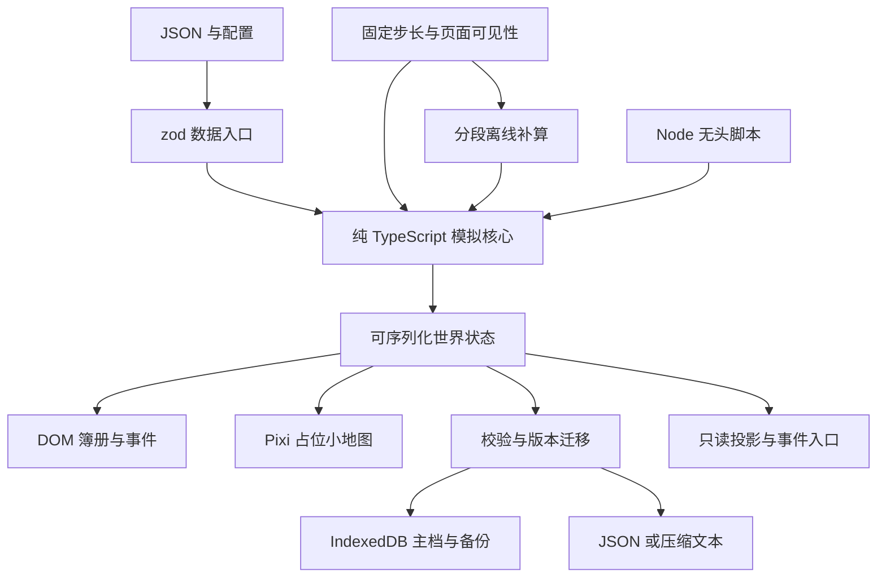

# 模拟仙府 M1 架构

## 模块图

## 状态与边界

`src/sim` 无 DOM、window、Pixi 引用；不读取系统时间，不使用 `Math.random`。调用者传时间戳与输入，随机保存种子、内部状态和调用次数。世界保存步、轮、季节、资源、弟子、建筑、事件队列、有限日志、随机和标记。日志最多一百条，待处理事件最多五条。

前台使用单一累加器，定时器仅唤醒它；实际推进由累积时长决定。隐藏前刷新 `lastSeen` 并保存，隐藏中自动保存不刷新离线起点。重新可见时一次性补算并重置前台累加器，避免双计。设置和 URL 加速只作用于前台时间。

离线使用 `seed + lastSeen` 派生随机内部状态，保留原始世界种子；相同完整世界与时间戳可复现。每轮调用三十步复用相同规则，七天上限只有 4,800 步，暂不引入 Worker。年龄上下文只对前八轮开放；离线突破计数在整个批次共享。筑基瓶颈修为封顶，余寿下限一季。已有坐化者不复活。

存储通过 `Storage.read/write` 抽象，生产 IndexedDB 采用 `setMany` 原子更新两键，测试可用内存或 fake-indexeddb。写入串行排队防止同页面重叠写入。每次排队前复制快照，模拟不会修改待写对象。导入在写入前完成所有验证，导入备份使用当前内存快照。主档损坏不会覆盖健康备份。尚无跨标签页写锁，应仅用一个主页面；内置小窗不会产生第二写入者。

老板键切换纯 DOM 工作台账并关闭弹窗；地图按状态变化重绘，没有常驻动画 ticker。小窗共享主窗口模型，主页面继续承担模拟；小窗存活且可见时维持前台时间。事件详情在主页面处理，避免两个独立决策状态。

## M1 占位清单

- 地图只有建筑色块、圆点弟子和姓名，明确标“占位图”，未使用正式美术与行走动画。
- 六位弟子字段与开局关系已对齐设计；特质字典提供稳定编号，当前只实现部分数值修正。
- 开局主殿、居舍；药圃资源分支预留，建造、升级与炼丹流程由 M2 接入。
- 行为为修炼、做工、社交、休息；岗位容量使用简化评分，没有争抢岗位、路径或关系收益。
- 小境界与筑基使用简易概率判定；前台突破直接结算，尚未进入完整事件护法流程。
- 一条开局事件展示选项与超时默认处理；完整二十事件、连锁暂停节点、关系变化汇总和传承录由 M2 实现。
- 离线保护完整实现，纪事当前记录突破；汇总结构可扩展其他事件提示，最多十条。已有连锁节点保留上限三条，当前不生成连锁节点。
- 声音仅开关，无音频；标题可自定义，favicon 使用内置 SVG。
- 图形后端不可用时显示中文提示并保留 DOM；不承诺 Pixi v8 自动 Canvas 回退。API 依据 [Pixi 官方 Application 文档](https://pixijs.com/8.x/guides/components/application) 与 [Graphics 文档](https://pixijs.com/8.x/guides/components/scene-objects/graphics)。

## 待 Lore 确认的参数

时间单位与离线保护已由指挥官拍板，不重复列为待定项。

| 参数             | 当前做法                             | 后续确认                             |
| ---------------- | ------------------------------------ | ------------------------------------ |
| 工作评分空缺岗位 | 简化为两个空缺，所有人可劳作         | M2 按实际建筑岗位竞争，校准每轮收入  |
| 年龄与剩余寿元   | 分开存储，长老余寿六季               | 确认延寿效果改变总寿元还是仅余寿     |
| 突破交互         | 前台够丹自动判定，离线不筑基         | 接入事件护法、暂缓与强冲             |
| 特质效果         | 勤勉、懒散、好胜及灵根部分加成       | 其余关系、同修、醉酒等效果随 M2 接入 |
| 离线余数         | 每次向下取整，丢弃不足一轮           | 是否需要跨会话保留余数               |
| 故事提示         | 突破与开局占位事件                   | 二十事件及关系档位变化接入           |
| 数值校准         | 仓库截断有效，收入未对齐三十分钟节奏 | 以一百种子节奏回归作为 M2 验收       |

## 验证范围

单测覆盖确定性、随机状态接续、步进等价、离线时间表与保护、库房、数据路径报错、固定累加器、存档往返、坏档拒绝、迁移、备份恢复与并发顺序。浏览器脚本覆盖真实构建页面的主要交互和持久化，输出截图供复核。

M1 不等于 M2 的三条完整故事、一百种子数值验收，也不等于十分钟真实前台稳定性或所有浏览器兼容验收。原生 Document PiP 需支持该 API 的实际浏览器环境进一步验证；自动化脚本专门覆盖普通 popup 回退。

本次环境实际限制：无头 Chrome 在创建页面前以 `SIGABRT` 退出；备用浏览器服务不可用。因此浏览器回归脚本已提供，但本次没有取得截图或浏览器验收通过结果，DOM、原生画中画和失焦隐藏仍待真实浏览器复核。
