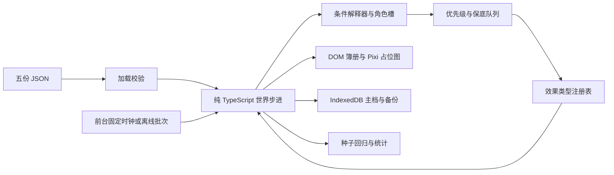

# 模拟仙府 M2 架构与验证边界

## 设计依据（只读引用）

完整系统依据：`/Volumes/Media/immortal-qa/design/02-systems-and-events.md`。
参考：同目录 `01-gameplay-core.md`、`03-web-tech-proposal.md`、`art/ART-STYLE-WEB-v1.md`。
设计源文件不复制入仓库。

## 数据与执行路径



- `data/traits.json`：恰好 10 种，效果参数、关系系数、互斥表和配饰。
- `data/buildings.json`：恰好 5 种，开局等级、升级上限、容量、成本、工期、产出、解锁条件、预留位。
- `data/events.json`：恰好 20 个，9 通用，A/B/C 各 3 个，D 2 个；包含条件树、角色槽、概率、冷却、保底、分支及可用选项。
- `data/balance.json`：原 M1 常量移入 JSON；包含灵根权重、五行色与倾向、需求与评分、寿元、公式、仓库、调度、离线分段及自动建造顺序。
- `data/roster.json`：六人固定开局，年龄与总寿元/余寿分开保存，人生阶段在创建世界时计算。
- `data/initial.json`：保留的 M1 旧数据样本，不再用于新局。默认加载资源与建筑来自 balance/buildings，弟子来自 roster。`loadData(raw)` 仍接受 M1 数据入口，保留其错误路径约定。

`schema.ts` 定义事件、条件、效果与目录 schema；`catalog.ts` 校验并加载；`data.ts` 校验弟子与初始世界；`config.ts` 对 balance 全字段类型与有限数值校验。数量、重复编号、未知条件/效果类型、缺少关键条件参数、提示/正文长度、互斥特质均拒绝加载。错误带中文文件和字段路径。

世界只保存可序列化对象，无 DOM、系统时间或 `Math.random`。随机状态含 seed/state/calls；所有平局、角色抽取、概率、招新均用同一发生器。生命周期、岗位分配、生产、关系、建造、默认决策、调度每步执行；每 30 步更新年龄、关系回归、建筑声望。日志保留最近 100 条，里程碑 tick 独立保存在 flags，不依赖日志长度统计。

建筑占据固定预留位；升级期间原等级功能继续使用。自动掌门默认开启，依次排药圃、静修室、炼丹房、居舍 Lv2、主殿 Lv2，最早第 1/2/3/4/5 轮开工。自动策略为下一建筑留建设资源；缺灵石/灵草时相应岗位优先，炼丹不挪用主殿建设储备。手动订单仍需满足相同解锁和成本规则。设置可以关闭自动掌门。

## 事件、角色与玩家 API

条件树通过 `matches(world, condition, roles)` 解释：特质、灵根、境界/需求/行为/地点字段、修为满、关系阈值/标签、建筑、资源/声望、前置及间隔、昼夜、人口/容量、受伤/回山/生产信号。`any/all` 组合子条件。角色槽递归筛选完整可行组合，然后按种子和权重抽选；薪火 B 槽先取最高关系。连锁首次选中的角色写入 cast，后续固定沿用，坐化节点仍可找到原角色。

每步检查，两个新事件至少隔 6 步；同人最多一个未结事件。先保底、再优先级，同档按特质/关系权重抽取。最大 5 个，溢出丢最低优先级非连锁；全是连锁时延后。冷却以角色和事件编号为键，从结算时起算。前台 30 步超时默认处理，连锁也适用；完成记录用于下一节点的前置判断。

```ts
resolveEvent(world, eventId, optionIndex); // 返回是否成功；不可用不改变世界
setPolicy(world, discipleId, '专修'); // 均衡、专修、勤工
build(world, 'B_GARDEN'); // 返回是否成功
upgrade(world, 'B_HALL'); // 同订单入口
```

选项先校验条件与成本，再扣资源和执行注册表。动态默认：筑基有三丹用赐丹，否则暂缓。其他带成本默认项不能负担时，自动处理使用首个可用选项；UI 显示成本并禁用不可用按钮。所有资源结算后截断到上限，声望不消耗、无上限。突破失败、延寿、传功、情缘分支、历练、招新、传承均由效果类型注册表执行。

## 离线与保存

沿用 M1 分段积分，按有效轮数循环 30 步，同批次共享小突破计数；最多两次成功小突破，不筑基，年龄最多八轮，余寿最低一轮。离线为 seed + lastSeen 派生随机状态，保留原 seed。小于零或非有限时间不补算，超过七天截断。

通用事件自动结算；连锁的每个选项节点均视作需玩家决策，最多保留三个，绝不超时自动选。入离线时已有四/五个连锁节点会暂存到可序列化 deferredEvents，回到前台有空间时恢复，避免截断丢剧情。离线汇总含资源、突破、关系档位变化及最多十条提示。零轮不改变世界。已经坐化的人不复活。

存档继续使用版本 2，新增字段有 schema 默认值，旧 M1 世界可载入；旧欢迎事件在超时后移除。版本 1 迁移规则保留。IndexedDB `xianfu/saves` 的 main/backup 同事务更新，导入前校验并备份当前内存进度；写入串行排队，坏档不覆盖健康备份。当前仍无跨标签页写锁，请只开一个主页面。页面关闭后的异步写入由浏览器决定，最近一次成功保存才是可靠恢复点。

## 占位清单

- 山场底图、山路、远景、云雾、预留位：几何图形；只一张山场，右上同场景缩略图，无世界地图。
- 五种建筑两档：矩形/屋顶色块，以等级或建成两轮后换色，进度图标代替工地动画。
- 男/女基础体、八类发型、五行镶边、十配饰、头像：圆点/文字与配饰占位符；镶边采用设计色。
- 四动作仅位置/颜色/箭头、打坐、锤、气泡符号；休息隐藏并在居舍显示 Zzz，历练隐藏，受伤换灰，迟暮标白发，坐化从地图移除。
- 资源、事件类型、状态、关系、配饰图标均为文字或 Unicode 占位；正式图集、配饰拼装和帧动画未接入。
- 老板页为 DOM 工作台账；页签图标为 SVG 字；音频只有开关。
- 480×320 隐藏簿册侧栏，只保留资源、缩放地图、提示条与红点；悬停展开，点击才打开决策。离线与战报不在紧凑模式主动弹出。

## 待 Lore 确认

以下均为歧义/未给数值的保守解释，不代表设计已拍板。

| 项目                | 当前实现与依据/待决策                                                                                                                                                  |
| ------------------- | ---------------------------------------------------------------------------------------------------------------------------------------------------------------------- |
| 昼夜                | 一轮前 15 步为昼、后 15 步为夜；设计未给划分。                                                                                                                         |
| 每轮 30%            | D1 每轮第一次条件满足时抽一次，失败本轮不重抽；保底后仍要求行为和精力条件满足。                                                                                        |
| 保底碰上间隔/角色忙 | 不越过 6 步间隔、同人唯一和条件要求，等下一合法步；因此“第 N 轮末”不等于无条件准时。                                                                                   |
| 开局与预留位        | 主殿/居舍 Lv1，另外三种各一个空位；五个固定坐标由现有 600×340 占位地图确定。                                                                                           |
| 开局需求            | 文档没有给定；保留 M1 精力 90、心境 75，道心从 M1 的 55 调为 20，使开局先修炼；写在 roster。                                                                           |
| 行为特质系数        | 多情社交评分 1.5、孤僻 0.5；文档只说特质修正未给评分值。勤勉修炼评分借用 1.2，懒散做工借用 0.8。                                                                       |
| 历练基础概率        | 从未指定时的每步 100% 改为 3%；防止历练反复占用故事人物。剑痴/金/福缘角色权重仍为 ×2。                                                                                 |
| 岗位排序与资源储备  | 文档无岗位争抢策略；工地 100，建设缺口 10，火炼丹 6，木药圃 5，其余炼丹 3/药圃 2/采石 1；自动掌门预留建设资金。数值在 balance.jobs。                                   |
| 做工评分括号        | 按 `(40 + 空缺岗位数×10) × 方针 × 特质`；文档排版也可理解为只乘后半项。空缺按岗位容量扣除正在占用的岗位计算。                                                          |
| 社交关系            | 一次社交结束，挑选在山关系最高且不低于 -19 的对象，双方各记一次增量；对方可以正在修炼。所有特质倾向相乘；多情的 ×1.5 与关系表同一效果，避免重复乘两次。                |
| 知己/道侣等叠加     | 同修的不同关系/标记乘法叠加；多个同修对象也逐个生效，设计未指定封顶。                                                                                                  |
| 主殿成本减免        | D2 的 30 灵石减免只记一次，不叠加；声望只判定不花费。                                                                                                                  |
| 丹药产出            | 成功一炉固定一枚；五行/杏林改成丹率，懒散和干劲不产生小数丹药。历练金灵根按收益 ×1.2，可出现 1.2 枚奖励，整数化规则待确认。                                            |
| 无力支付默认项      | 默认成本不足时使用首个可用选项（如接风改直接入库、大宴改从俭）；不会透支。除筑基之外设计未定义此默认回退。                                                             |
| 冷却作用域          | 从结算起按事件+主角计时；无主角事件按宗门计。文档未说明共享还是每人独立。                                                                                              |
| 事件持续条件        | 触发时锁定正文/分支/角色；结算不重新要求当时的行为，但重验选项成本及可用条件。                                                                                         |
| 招新                | 姓名池为云知秋、叶听雨、顾长风、宁小满、楚望舒、柳归舟；可重名但 ID 唯一；年龄 14～25.75 岁，性别等概率，第二特质 50%，杂灵根 4/5 五行等概率；这些范围未由 Lore 给定。 |
| 长老寿元            | 179 岁与 180 岁总寿元差 4 季，但阵容指定余 6 季；以显式余寿 6 为准。延寿增加余寿，不重写历史年龄。                                                                     |
| 薪火节奏            | B1 最早第 2 轮末达到余寿 4，默认再延 1；B2 最早第 5 轮末达到余寿 2。与目标 B2 第 4 轮冲突；超时默认还会再推迟。未改给定余寿/阈值。                                     |
| 冰与酒节奏          | C1 默认 +15 后距离 C2 的 30 仍有缺口；多情对孤僻初期 ×0.8、孤僻 ×0.5，再叠加回归，六轮未能自然衔接 C2。未修改关系阈值或额外发关系。                                    |
| 离线示例            | 分段积分为 8 小时→45.6 轮、24 小时→74.4 轮、七天→160.8 轮，再向下取整为 45/74/160；示例“约等于”与整数结果一致，并非额外补轮。                                          |
| 离线粗步长          | 沿用 M1 每轮内部 30 步复用模拟，非另写一套近似公式；上限 4800 步，未引入 Worker。                                                                                      |
| 离线自动营造        | 关闭自动排新建设，但继续已有工程；避免长离线替玩家直接完成终局。是否允许离线新建待确认。                                                                               |
| 离线决策节点        | 所有连锁节点都有选项，因此全部视作需玩家决策；通用事件仍自动结算。                                                                                                     |
| 回顾本命弟子        | 当前按大境界、层数、修为排序推荐；没有单独的本命选择系统。                                                                                                             |

## 实际验证与尚未通过的验收

`npm run build`、`npm test`、`npm run lint` 和两条要求的 sim 命令见本次交付记录。单测覆盖 M1 保存/恢复/离线/可复现以及 M2 条件、互斥、数量、文案、工期、成本拒绝、角色锁定、保底、逐步资源边界和每个事件分支效果结算。M1 的“被动产出与自然寿元”测试增加关闭自动掌门与排除薪火延寿的隔离条件；其“队列为空”改为“没有过期未处理事件”，因为 M2 会持续产生事件，保留原断言会把正确的新事件当故障。

100 种子结果在 `docs/sim-100.json`（出现即默认）和 `docs/sim-idle-100.json`（零操作超时默认）；包含命中样本数，未命中用 null，避免把零次触发报告成第零轮。当前经济主殿完成率已达 90% 门槛，但故事与部分时序未通过第 7 节验收 7/8，不能宣称 M2 全部验收。

浏览器脚本 `scripts/e2e.mjs` 使用外部 preview 地址，不管理服务。此次 preview 可以启动，Chrome 在创建页面前 SIGABRT 退出；自启 preview 已关闭。六张截图和 10 分钟等效挂机尚无通过证据。`--soak` 用前台 speed=100 实际时钟推进至少 66 步（660 游戏秒），验证自动事件与资源并采集 console/pageerror。未用 debug.advance 替代挂机时间。失败也会输出失败 JSON，绝不冒充通过。
